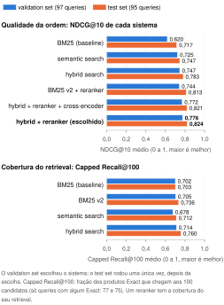
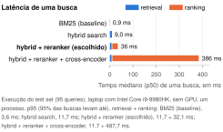
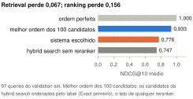

# Busca e ranking de produtos no WANDS

Nota técnica · 9 de novembro de 2026

- **O que é:** um sistema que recebe um texto de busca (a **query**) e devolve os produtos mais relevantes entre os 42.994 do catálogo do WANDS, um dataset público da Wayfair com móveis e decoração. O **retrieval** escolhe candidatos no catálogo inteiro, e o **ranking** reordena os 100 primeiros com um modelo treinado por nós.
- **Sistema escolhido:** **hybrid search** (lexical search + semantic search) seguida de um **reranker LambdaMART** com 29 features, sem cross-encoder.
- **Resultado:** a qualidade é medida pelo **NDCG@10**, uma nota de 0 a 1 que mede se os melhores produtos aparecem nas 10 primeiras posições. No test set (95 queries), o sistema escolhido tem **NDCG@10 de 0,824**: em média, os 10 primeiros resultados alcançam 82% da nota da melhor ordem possível com os produtos julgados de cada query. Produtos não julgados contam como errados, então 0,824 é provavelmente um piso (seção 7).
- **Custo:** uma busca leva cerca de **36 ms** num laptop sem GPU, somando as medianas de retrieval (9 ms) e de ranking (27 ms).
- **Busca de ponta a ponta:** `notebooks/05_search.ipynb` busca qualquer texto com o sistema escolhido (troque `QUERY` e execute); em Python, `wands_search.search.SearchPipeline`.
- **Principal ressalva:** só uma parte dos produtos foi julgada para cada query. O ganho do ranking vem de trazer ao topo produtos que foram julgados, e os dados não dizem se isso é uma melhora real para quem busca (seção 4).

<b>Query</b>Texto livre. Vazio ou não texto: erro. Só caracteres especiais: 0 resultados. Mais de 500 caracteres: cortado.

→

<b>Retrieval: hybrid search</b>BM25 (palavras) e embeddings (significado), combinados por RRF. Saída: 200 produtos.

→

<b>Ranking: reranker</b>LightGBM LambdaMART com 29 features reordena os 100 primeiros.

→

<b>Resultado</b>Lista ordenada e o tempo de cada etapa.

## 1. Arquitetura

- **Lexical search:** BM25 (`bm25s`; `k1 = 1.2` e `b = 0.5`, escolhidos no train set) sobre os cinco fields de texto.
- **Semantic search:** embeddings de `BAAI/bge-small-en-v1.5`, pré-treinado e sem fine-tuning (`fastembed`, ONNX, só CPU), comparados por cosine similarity com todo o catálogo.
- **Hybrid search:** Reciprocal Rank Fusion (RRF, k = 60) das duas listas.
- **Reranker:** LambdaMART (LightGBM) treinado com 29 features em quatro grupos: **retrieval** (scores e posições nas três buscas), **text** (BM25 e fração da query em cada field; números da query no produto), **numeric** (ratings, tamanho da descrição, número de atributos) e **query** (tamanho; presença de número). Nenhuma usa o identificador do produto, a classe da query ou os julgamentos. Treinado nos 100 primeiros candidatos de cada query do train set, com o julgamento como nota-alvo (sem julgamento = 0); hiperparâmetros (15 folhas, taxa de aprendizado 0,1, 100 árvores) escolhidos entre 72 combinações por validação cruzada.

## 2. Preparação dos dados

- **label:** **Exact** (atende à query), **Partial** (tipo certo, mas falta algum detalhe pedido) ou **Irrelevant**. Restam 231.859 julgamentos, sem duplicatas e sem pares contraditórios, e 479 queries, sem a única que não tem nenhum Exact ou Partial.
- **Texto dos produtos:** os cinco fields num texto só, sem preencher valores nulos. No BM25, plurais viram singular e saem de `product_features` os valores "yes", "no" e só numéricos.
- **Reprodutibilidade:** dataset original inalterado; seeds, parâmetros e versões no código e no `uv.lock`; 280 testes automatizados.

## 3. Protocolo de avaliação

- **Split por query** (60/20/20, cada query inteira num set, estratificado pela proporção de Exact e pelo número de produtos julgados, seed 87): **train set** (287 queries) para escolher parâmetros e treinar o reranker, com validação cruzada em 5 folds de queries; **validation set** (97) para comparar e escolher o sistema; **test set** (95), rodado **uma única vez**, depois da escolha registrada.
- **Métricas** (de 0 a 1, maior é melhor):
  - **NDCG@10 (principal):** Exact vale 2, Partial 1, Irrelevant e produto sem julgamento 0.
  - **condensed NDCG@10:** o NDCG@10 depois de retirar da lista os produtos sem julgamento; mostra se um ganho depende deles.
  - **Capped Recall@100 (retrieval):** fração dos produtos Exact que chegam aos 100 candidatos.
  - **MRR@10:** 1 dividido pela posição do primeiro Exact no top 10.

  Capped Recall@100 e MRR@10 só existem em queries com algum Exact (77 no validation set e 75 no test set).
- **Significância:** paired bootstrap, com 2.000 reamostragens das queries. **Escolha:** o maior Recall@100 ou NDCG@10 no validation set, ou o sistema ou componente mais simples quando a diferença não é distinguível de 0.

## 4. Resultados

- **O sistema escolhido (hybrid + reranker ) tem o maior NDCG@10 nos dois sets:** 0,776 no validation set e 0,824 no test set.

<figure></figure>

- **O test set mantém a ordem do validation set, com uma troca:** o BM25 v2 + reranker passa à frente da hybrid search. Todos os sistemas têm NDCG@10 maior no test set, o que indica um test set mais fácil para todos, e não um efeito da escolha.
- **O reranker melhora a hybrid search.** O NDCG@10 sobe de 0,747 para 0,776 no validation set e de 0,783 para 0,824 no test set. Nos dois sets, a melhora é estatisticamente significativa.
- **No test set, o sistema escolhido não se distingue do BM25 v2 + reranker** (NDCG@10 de 0,824 contra 0,813). No validation set, usado na escolha, o sistema escolhido era melhor, com diferença significativa.
- **Retrieval:** no test set, a hybrid search põe mais produtos relevantes entre os 100 candidatos que o BM25 v2: Capped Recall@100 de 0,760 contra 0,736 contando só os Exact, e de 0,700 contra 0,662 contando Exact e Partial. No validation set, só a segunda diferença é estatisticamente significativa. A métrica pode favorecer o BM25 (seção 7).

**O que o reranker agrega** (validation set, mesmos 100 candidatos, NDCG@10):

- **Ordenação:** o reranker com o cross-encoder ("hybrid + reranker + cross-encoder" no gráfico, 0,772) supera, com diferença significativa, a ordem da hybrid search (0,747) e duas alternativas que não estão no gráfico: o cross-encoder sozinho ordenando os candidatos (0,720) e o mesmo modelo de árvores treinado para dar nota a cada produto isoladamente, sem comparar pares (0,740).
- **Cross-encoder:** sem ele, o reranker fica em 0,776 ("hybrid + reranker (escolhido)" no gráfico), diferença não distinguível de 0; pela regra de escolha, fica essa versão, cerca de 13 a 14 vezes mais rápida no ranking.
- **Features:** um estudo de ablação (treinar de novo sem um grupo de features por vez) mostra que nem todos os grupos agregam: sem os ratings, as outras features numéricas e as da query, o NDCG@10 não muda de forma mensurável. Eles continuam no modelo; retirá-los e medir de novo fica como trabalho futuro.
- **Ressalva:** contando só os produtos julgados (condensed NDCG@10), o sistema escolhido e a hybrid search sem reranker ficam praticamente iguais no test set (0,856 contra 0,857, diferença não distinguível de 0), e o MRR@10 também não muda. O reranker sobe a nota porque leva ao topo produtos julgados no lugar de produtos sem julgamento, sem melhora detectável na ordem dos julgados. Isso pode ser uma melhora real (tirar do topo produtos fora do assunto) ou existir só na métrica (tirar do topo produtos relevantes que não foram julgados), e os julgamentos não separam os dois. Numa leitura pelo assistente de IA dos produtos retirados do topo, a segunda parte parece a maior (seção 7).

## 5. Latência e custo

<figure></figure>

- **Busca:** o ranking é a etapa mais cara, cerca de 30 ms (mais de 370 ms com o cross-encoder). Ele recalcula o embedding da query, o BM25 e a RRF que o retrieval já calculou; reaproveitá-los reduziria o tempo sem mudar a ordem.
- **Preparação, feita uma vez:** embeddings do catálogo, cerca de 37 min (66 MB por texto, em cache); índice BM25, 10 a 22 s; tuning do reranker, cerca de 12 min; treino final, cerca de 3 min. Um produto novo exige calcular os seus embeddings e reconstruir o índice BM25 (`bm25s` não acrescenta documentos); o reranker não precisa ser retreinado.
- Tempos de uma única máquina (Intel Core i9, sem GPU), que variam entre execuções.

## 6. Error analysis

Comparamos o sistema com a melhor ordem possível dos seus próprios 100 candidatos (todos os Exact primeiro), no validation set. A perda de uma query é 1 − NDCG@10, e as porcentagens abaixo são partes da perda somada nas 97 queries. Cada query abaixo de 0,9 foi atribuída inteira a uma categoria, então as porcentagens são aproximadas. As categorias de erro e as correções de typo abaixo foram atribuídas pelo assistente de IA, numa única leitura dos fields, sem revisão humana.

<figure></figure>

- **A perda está no ranking, não no retrieval:** os produtos relevantes quase sempre já estão entre os candidatos, que permitiriam 0,933; o sistema chega a 0,776. Cerca de 70% da perda está no ranking, e o reranker recupera só cerca de 16% do que havia para recuperar com os mesmos candidatos. Melhorar o reranker rende mais do que buscar mais candidatos. Todos esses números contam só os produtos julgados.
- **Causas visíveis nos dados, que o reranker poderia corrigir (29% da perda):**
  - produto de outro tipo no topo, como lâmpadas LED para "beds that have leds";
  - atributo pedido não atendido: em "tufted chair with gold legs", 21 dos 28 Exact têm perna dourada nos atributos, e nenhum dos 4 produtos mal colocados tem.
- **Limite do dataset (21% da perda):** em 15 queries, nenhum field explica por que os produtos mal colocados são Partial e os outros, Exact. Por exemplo, dois headboards com a mesma descrição e a mesma cor diferem em 1 de 66 atributos, e só um é Exact. Nenhum sistema que use só estes dados consegue separá-los; os anotadores viram a imagem do produto, que não está no dataset, então o julgamento pode estar certo. Ainda assim, os julgamentos são consistentes na maior parte dos casos: 5,6% dos pares de produtos quase idênticos têm julgamentos diferentes, contra 34,4% de pares quaisquer. Por isso a perda medida reflete, na maior parte, erros do sistema, e não ruído de anotação.
- **Typos:** a query corrigida ("small living room tables") traz produtos que nunca foram julgados, então o ganho de um corretor ortográfico não pode ser medido.

## 7. Limitações e próximos passos

- **Avaliação incompleta (pooling bias):** só foram julgados os candidatos que a Wayfair escolheu (cliques, carrinho, buscas por palavras e neural, classe prevista). Um produto bom não julgado vale 0, então o NDCG@10 é provavelmente um piso (no validation set, 0,776; sem os não julgados, 0,831), e o Capped Recall@100 pode favorecer o BM25. Isso limita a avaliação, não o aprendizado: o sistema aprende a ordenar os produtos julgados, mas não há como medir se um produto bom não julgado chega ao topo.
- **Amostra pequena:** com cerca de 95 queries por set, o NDCG@10 médio de cada sistema tem incerteza de cerca de ±0,05, e diferenças de 0,01 a 0,03 entre sistemas parecidos ficam no limite do que o paired bootstrap detecta.
- **Comparações múltiplas:** muitas comparações foram feitas no mesmo validation set, sem correção. Cada uma tem 5% de chance de parecer significativa por acaso. O test set confirma a melhora do reranker sobre a hybrid search, mas não a vantagem do sistema escolhido sobre o BM25 v2 + reranker.
- **Foco nos 10 primeiros:** reranker e escolha foram otimizados para o top 10 (NDCG@10), e o retrieval pelo Capped Recall@100, que não olha a ordem; nenhuma métrica usada nas decisões mede as posições 11 a 100.
- **Um único modelo de embeddings, sem fine-tuning:** só o `bge-small-en-v1.5` foi testado.
- **Feature de números incompleta:** `number_match`, criada para as queries com número, ignora as dimensões que ficam em `product_features` e não casa "5x6" com "5 x 6" (por exemplo, na query "carpet 5x6"). 
- **Próximos passos, em ordem de prioridade** (detalhes e riscos no `docs/EVALUATION.md`, "Trabalhos futuros"):
  1. **Medir quanto do ganho do reranker é real:** julgar uma amostra dos produtos sem julgamento que ele tira ou põe no top 10 e recalcular o NDCG@10.
  2. **Tipo de produto da query contra `product_class`** (21% da perda): considerar um classificador de query.
  3. **Atributos:** ligar a query às keys de `product_features`, como `legcolor` em "gold legs" (9% da perda).
  4. **Corrigir `number_match`.**
  5. **Testar outros embedding models pré-treinados.**
  6. **Corretor ortográfico.**
  7. **Avaliar além do top 10** (NDCG@50, NDCG@100).

## 8. Uso de IA generativa e de modelos pré-treinados

- **Ferramenta e escopo:** o Claude Code (Anthropic) foi usado como assistente de desenvolvimento durante todo o projeto e foi responsável por todo o código e por boa parte da redação das análises e da documentação.
- **Papel do autor:** o autor supervisionou e definiu cada etapa, tomou as decisões de produto e estabeleceu as perguntas que cada etapa precisava responder e os critérios de decisão, exigindo justificativa e análise de impacto. As decisões de design foram do autor, entre elas a regra de seleção dos modelos. Cada decisão está registrada no `docs/EVALUATION.md`, com data, alternativas consideradas e motivo.
- **Revisão:** a suíte de testes foi executada, e o código foi revisado por uma instância do Claude Opus 5.5 separada da sessão que o escreveu. O autor revisou a documentação.
- **Modelos pré-treinados, sem fine-tuning:** `BAAI/bge-small-en-v1.5` (semantic search) e `ms-marco-MiniLM-L-6-v2` (cross-encoder). O reranker LambdaMART foi treinado do zero.

